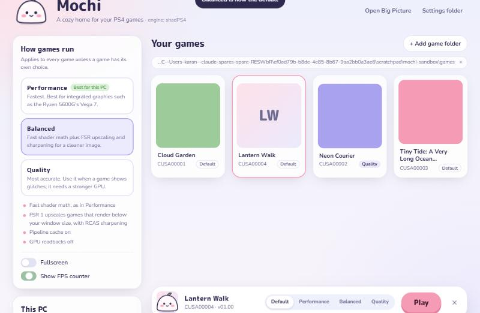

<!--
SPDX-FileCopyrightText: 2026 Karan (Mochi), based on the shadPS4 Emulator Project
SPDX-License-Identifier: GPL-2.0-or-later
-->

<p align="center">
  
</p>

<h1 align="center">Mochi</h1>

<p align="center">
  A cozy home for your PS4 games on Windows.<br>
  Built on the <a href="https://github.com/shadps4-emu/shadPS4"><b>shadPS4</b></a> emulator, tuned for modest PCs.
</p>

<p align="center">
  
  <br><sub>The Mochi launcher (the games shown are made-up test entries)</sub>
</p>

## What Mochi is

Mochi has two parts:

- **The engine:** a fork of [shadPS4](https://github.com/shadps4-emu/shadPS4), the open-source PS4 emulator. It keeps shadPS4's emulation as it is, with Mochi's name and icon on the windows.
- **The launcher** (`fork/mochi`): a friendly app that:
  - reads your PC's hardware and picks the best preset for it
  - applies **Performance**, **Balanced** or **Quality** to shadPS4's settings
  - lets each game have its own preset
  - shows your games with their cover art and starts them

> [!IMPORTANT]
> Mochi is early. The engine builds and the launcher works, but it hasn't yet been tested with a real game on its target PC (Ryzen 5 5600G, integrated Radeon graphics). Expect what shadPS4 itself expects: many games run, many don't yet.

## Presets

| | Performance | Balanced | Quality |
|---|---|---|---|
| Best for | Integrated graphics | Mid-range GPUs | Games with visual glitches |
| Fast shader math | On | On | Off (exact) |
| FSR upscaling + sharpening | Off | On | On |
| GPU readbacks | Off | Off | Relaxed (more accurate, slower) |
| Shader pipeline cache | On | On | On |

The presets are plain JSON files in [`fork/mochi/presets`](fork/mochi/presets). Each one changes only its own keys in shadPS4's `config.json`.

## Getting started (Windows)

**1. Build the engine.** You need Visual Studio Build Tools with the C++ Clang compiler, CMake and the Windows 11 SDK, plus Git.

```bat
git clone --recursive https://github.com/kristoholick/emulator.git mochi
cd mochi
fork\build.cmd
```

That builds `Build\x64-Clang-Release\shadps4.exe`, the Mochi engine (the file keeps shadPS4's name).

**2. Open the launcher.** It needs Python 3 and Microsoft Edge, which comes with Windows.

```bat
fork\mochi\Mochi.cmd
```

**3. Add your games.** Click **Add game folder** and choose the folder with your game dumps. Each game folder contains `eboot.bin` and `sce_sys\param.sfo`.

## What you need to supply

- **Your own games:** decrypted dumps from a PS4 you own.
- **Firmware modules:** some games need system modules dumped from your own console. See the [firmware section of the shadPS4 README](README.shadPS4.md#firmware-files).

Mochi doesn't include, download or link to games or firmware.

## Project layout

| Path | What's there |
|---|---|
| `fork/mochi/` | The launcher: `core.py` (logic), `mochi.py` (local server and window), `web/` (UI), `presets/`, `test_core.py` |
| `fork/build.cmd` | One-click Release build with Clang |
| `FORK_PLAN.md` | Settings notes for this PC and the roadmap |
| `src/`, `externals/`, … | The shadPS4 engine, plus Mochi's small branding changes |

Mochi's changes to shadPS4's own code are deliberately small (icons, window titles, file details), so new shadPS4 versions can be pulled in:

```bat
git remote add upstream https://github.com/shadps4-emu/shadPS4
git fetch upstream
git rebase upstream/main
```

## Credits and license

Mochi exists because of **shadPS4** and its contributors. All of the emulation is their work. Their original README, with the team, special thanks, controls and firmware list, is kept in [**README.shadPS4.md**](README.shadPS4.md). Please support the original project: [website](https://shadps4.net/) · [GitHub](https://github.com/shadps4-emu/shadPS4) · [Ko-fi](https://ko-fi.com/shadps4).

Mochi, like shadPS4, is licensed under the [**GPL-2.0-or-later**](LICENSE). Anyone who shares a build must also share its source under the same license.

Mochi isn't affiliated with or endorsed by the shadPS4 team or Sony Interactive Entertainment. "PlayStation" and "PS4" are trademarks of Sony Interactive Entertainment.
